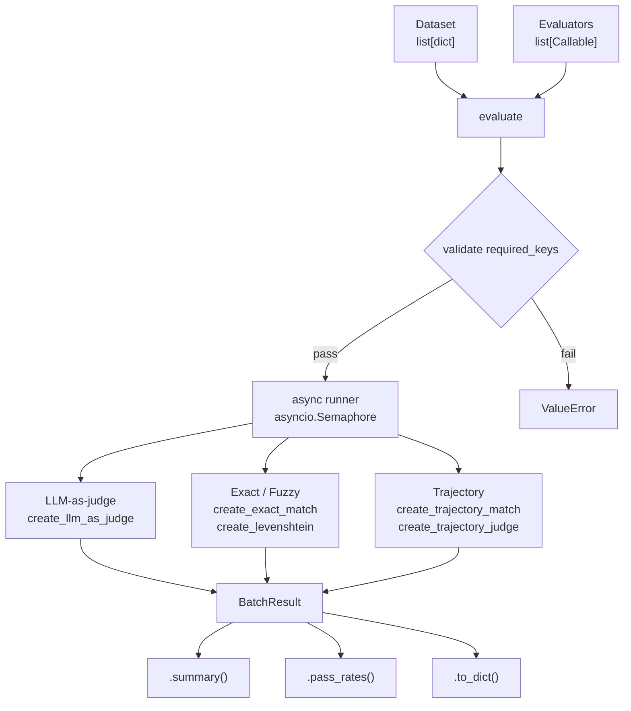

# nanoevals

> **A nano, minimalistic, and lightweight evaluation framework for LLMs and ReACT-based agent pipelines.**

[](https://pypi.org/project/nanoevals/)
[](https://pypi.org/project/nanoevals/)
[](LICENSE)
[](https://codebasics.io)

---

## What is nanoevals?

`nanoevals` is a minimal but feature-rich evaluation framework for LLM pipelines and [nanoagents](https://github.com/codebasics-community/nanoagents)-based agents.

You bring your own LLM callable. The library handles prompt formatting, parallel execution, output parsing, and result aggregation.

- **Zero mandatory dependencies** — pure Python core
- **Async-native** — `asyncio.Semaphore`-controlled concurrency
- **Dual API** — functional factories *or* subclassable base classes
- **Agent-aware** — first-class trajectory evaluation for `nanoagents.Step`
- **CI-ready** — built-in pytest plugin with a summary report

This is a **Codebasics community project** — built in public, contributions welcome.

---

## How it works



Each evaluator is a plain callable: `(**kwargs) → EvalResult`.  
Evaluators are produced by **factory functions** or **subclassing a base class** — both styles are fully interchangeable.

---

## Installation

```bash
# Preferred
uv add nanoevals

# pip
pip install nanoevals
```

Requires **Python ≥ 3.11**.  
No mandatory dependencies — bring your own LLM client.

---

## Quick Start

### 1. LLM-as-judge evaluation

```python
from groq import Groq
from nanoevals import evaluate, create_llm_as_judge, FAITHFULNESS_PROMPT

# ── Your LLM callable (raw string or messages list, sync or async) ──────────
def call_llm(prompt: str) -> str:
    client = Groq(api_key="YOUR_GROQ_API_KEY")
    response = client.chat.completions.create(
        model="llama-3.3-70b-versatile",
        messages=[{"role": "user", "content": prompt}],
    )
    return response.choices[0].message.content


# ── Build evaluators ─────────────────────────────────────────────────────────
faithfulness = create_llm_as_judge(
    prompt=FAITHFULNESS_PROMPT,
    llm=call_llm,
    feedback_key="faithfulness",
    continuous=True,          # float 0–1 instead of bool
)


# ── Run over a dataset ───────────────────────────────────────────────────────
dataset = [
    {
        "inputs":   "What is RAG?",
        "outputs":  "RAG means Retrieval Augmented Generation.",
        "contexts": ["RAG retrieves relevant documents before generating."],
    },
]

results = evaluate(dataset, evaluators=[faithfulness], concurrency=4)
print(results.summary())
# → {'faithfulness': 0.92}
```

### 2. No-LLM evaluators

```python
from nanoevals import create_exact_match, create_levenshtein, evaluate

exact = create_exact_match()
fuzzy = create_levenshtein(threshold=0.85)

results = evaluate(
    dataset=[{"outputs": "Paris", "reference_outputs": "paris"}],
    evaluators=[exact, fuzzy],
)
print(results.summary())
# → {'exact_match': 1.0, 'levenshtein': 1.0}
```

### 3. Agent trajectory evaluation

Works directly with `nanoagents.Step` objects or plain dicts.

```python
from nanoevals import create_trajectory_match, evaluate

trajectory_match = create_trajectory_match(
    match_mode="unordered",     # strict | unordered | subset
    tool_args_mode="partial",   # exact | ignore | partial
)

dataset = [
    {
        "outputs": agent.history,          # list[Step] from nanoagents
        "reference_outputs": [
            {"action": "add",      "input": {"a": 5184,    "b": 3348432}},
            {"action": "multiply", "input": {"a": 3353616, "b": 29}},
        ],
    }
]

results = evaluate(dataset, evaluators=[trajectory_match])
print(results.summary())
# → {'trajectory_match': 1.0}
```

---

## Prebuilt Prompts

Import any prompt directly from `nanoevals`:

```python
from nanoevals import (
    # Quality
    CORRECTNESS_PROMPT, CONCISENESS_PROMPT, HALLUCINATION_PROMPT,
    ANSWER_RELEVANCE_PROMPT, LAZINESS_PROMPT,
    # RAG
    FAITHFULNESS_PROMPT, CONTEXT_PRECISION_PROMPT, CONTEXT_RECALL_PROMPT,
    # Safety
    TOXICITY_PROMPT, BIAS_PROMPT, PII_LEAKAGE_PROMPT,
    # Agent
    TRAJECTORY_QUALITY_PROMPT, TOOL_SELECTION_PROMPT,
    GOAL_COMPLETION_PROMPT, STEP_EFFICIENCY_PROMPT,
)
```

All prompts are plain f-strings — inspect and modify them freely.

---

## Custom Evaluators

### Option A — Functional factory (quick, composable)

```python
from nanoevals import create_llm_as_judge

my_eval = create_llm_as_judge(
    prompt="Is this answer helpful? {outputs}\nJSON: {{\"score\": <true|false>, \"comment\": \"...\"}}",
    llm=call_llm,
    feedback_key="helpfulness",
)
```

### Option B — Class-based (reusable, typed, shareable)

Subclass one of the four base classes and implement a single method:

#### `BaseEvaluator` — sync logic, no LLM

```python
from nanoevals import BaseEvaluator, EvalResult

class WordCountEvaluator(BaseEvaluator):
    feedback_key = "concise"
    required_keys = {"outputs"}

    def __init__(self, max_words: int = 50):
        self.max_words = max_words

    def score(self, outputs: str, **_) -> EvalResult:
        count = len(outputs.split())
        passed = count <= self.max_words
        return EvalResult(
            key=self.feedback_key,
            score=passed,
            comment=f"{count} words (limit: {self.max_words})",
        )

results = evaluate(dataset, evaluators=[WordCountEvaluator(max_words=30)])
```

#### `LLMEvaluator` — implement `build_prompt()` only

```python
from nanoevals import LLMEvaluator, EvalResult

MEDICAL_PROMPT = """
You are a medical expert. Evaluate the answer for clinical accuracy.
<question>{question}</question>
<answer>{outputs}</answer>
JSON: {{"score": <true|false>, "comment": "..."}}
"""

class MedicalAccuracyEvaluator(LLMEvaluator):
    feedback_key = "medical_accuracy"
    required_keys = {"outputs", "question"}

    def build_prompt(self, outputs: str, question: str, **_) -> str:
        return MEDICAL_PROMPT.format(outputs=outputs, question=question)

ev = MedicalAccuracyEvaluator(llm=call_llm, continuous=True)
result = ev(outputs="Insulin regulates blood sugar.", question="What does insulin do?")
```

#### `AsyncBaseEvaluator` — async external APIs

```python
from nanoevals import AsyncBaseEvaluator, EvalResult
import httpx

class ToxicityAPIEvaluator(AsyncBaseEvaluator):
    feedback_key = "toxicity"
    required_keys = {"outputs"}

    async def score(self, outputs: str, **_) -> EvalResult:
        async with httpx.AsyncClient() as client:
            resp = await client.post("https://your-toxicity-api.com", json={"text": outputs})
        data = resp.json()
        return EvalResult(key=self.feedback_key, score=data["is_safe"])
```

#### `TrajectoryEvaluator` — custom agent trajectory logic

```python
from nanoevals import TrajectoryEvaluator, EvalResult

class NoRepeatedToolsEvaluator(TrajectoryEvaluator):
    feedback_key = "no_repeated_tools"

    def evaluate_steps(self, steps: list, **_) -> EvalResult:
        actions = [s.get("action") if isinstance(s, dict) else s.action for s in steps]
        seen, repeated = set(), []
        for a in actions:
            if a in seen: repeated.append(a)
            seen.add(a)
        return EvalResult(
            key=self.feedback_key,
            score=not repeated,
            comment=f"Repeated tools: {repeated}" if repeated else "No tools repeated.",
        )
```

All four class types plug directly into `evaluate()` — no extra wiring needed.

---

## Pytest Integration

Register the plugin in `conftest.py`:

```python
# conftest.py
pytest_plugins = ["nanoevals.pytest_plugin"]
```

Or it registers automatically if installed (via `pyproject.toml` entry point).

```python
# test_rag.py
def test_faithfulness(nanoevals_report):
    result = faithfulness_evaluator(
        inputs="What is RAG?",
        outputs="RAG means Retrieval Augmented Generation.",
        contexts=["RAG retrieves documents before generation."],
    )
    nanoevals_report.add(result, test="test_faithfulness")
    assert result.score >= 0.7, result.comment
```

At the end of the session, nanoevals prints a summary table:

```
========================================================================
nanoevals report
========================================================================
Test                       Evaluator                  Score  Status
------------------------------------------------------------------------
test_faithfulness          faithfulness               0.920  ✓ PASS
test_correctness           correctness                1.000  ✓ PASS
test_correctness_wrong     correctness                0.000  ✗ FAIL
------------------------------------------------------------------------
Summary (mean scores):
  faithfulness               0.920
  correctness                0.500
========================================================================
```

Skip integration tests without an API key:

```bash
# Unit tests only (no API key needed)
pytest tests/ -v -m "not integration"

# All tests
GROQ_API_KEY=sk-... pytest tests/ -v
```

---

## API Reference

### `evaluate(dataset, evaluators, *, concurrency=4, on_progress=None) → BatchResult`

| Parameter | Type | Description |
|---|---|---|
| `dataset` | `list[dict]` | One dict per sample — keys passed as kwargs to evaluators |
| `evaluators` | `list[Callable]` | Factory-produced callables or base-class instances |
| `concurrency` | `int` | Max parallel evaluator calls (default `4`) |
| `on_progress` | `Callable[[int, int], None]` | Optional `(done, total)` progress callback |

Also available: `await async_evaluate(...)` for use inside an event loop.

---

### `create_llm_as_judge(prompt, llm, *, feedback_key, continuous, choices, few_shot_examples, system)`

| Parameter | Type | Default | Description |
|---|---|---|---|
| `prompt` | `str` | — | f-string template; variable names passed as kwargs |
| `llm` | `Callable` | — | Your LLM (sync/async, raw string or messages list) |
| `feedback_key` | `str` | `"score"` | Key in `EvalResult` |
| `continuous` | `bool` | `False` | Coerce bool → `0.0`/`1.0` |
| `choices` | `list[float]` | `None` | Snap score to nearest value |
| `few_shot_examples` | `list[dict]` | `None` | Examples appended to prompt |
| `system` | `str` | `None` | System message for the judge |

---

### `create_trajectory_match(*, match_mode, tool_args_mode)`

| Parameter | Options | Description |
|---|---|---|
| `match_mode` | `strict` / `unordered` / `subset` | How to compare step sequences |
| `tool_args_mode` | `exact` / `ignore` / `partial` | How to compare tool arguments |

---

### `EvalResult`

```python
@dataclass
class EvalResult:
    key:      str              # evaluator name
    score:    float | bool     # 0.0–1.0 or True/False
    comment:  str              # reasoning from the LLM or evaluator
    metadata: dict             # raw response, error details, etc.

    def passed(self, threshold: float = 0.5) -> bool: ...
```

### `BatchResult`

```python
result.summary()          # → dict[str, float]  mean score per key
result.pass_rates(0.7)    # → dict[str, float]  fraction passing threshold
result.to_dict()          # → list[dict]         flat JSON-serialisable export
```

---

## Base Classes

| Class | Implement | Use case |
|---|---|---|
| `BaseEvaluator` | `score(**kwargs) → EvalResult` | Sync logic (regex, rules, math) |
| `AsyncBaseEvaluator` | `async score(**kwargs) → EvalResult` | Async APIs, databases |
| `LLMEvaluator` | `build_prompt(**kwargs) → str` | LLM-based, custom domain prompts |
| `TrajectoryEvaluator` | `evaluate_steps(steps, **kwargs) → EvalResult` | Agent trajectory logic |

All classes expose `feedback_key` and `required_keys` as `ClassVar[str]` / `ClassVar[set[str]]`.

---

## Works great with nanoagents

```python
from nanoagents import Agent
from nanoevals import evaluate, create_trajectory_match, create_trajectory_judge

# Run your agent
agent = Agent(llm=call_llm)
agent.run("Calculate (5184 + 3348432) * 29")

# Evaluate the trajectory
match = create_trajectory_match(match_mode="subset", tool_args_mode="ignore")
judge = create_trajectory_judge(llm=call_llm, continuous=True)

results = evaluate(
    dataset=[{
        "inputs":           "Calculate (5184 + 3348432) * 29",
        "outputs":          agent.history,
        "final_answer":     agent.final_answer,
        "reference_outputs": [
            {"action": "add"},
            {"action": "multiply"},
        ],
    }],
    evaluators=[match, judge],
)
print(results.summary())
# → {'trajectory_match': 1.0, 'trajectory_quality': 0.95}
```

---

## Project Structure

```
nanoevals/
├── __init__.py         # public API
├── types.py            # EvalResult, SampleResult, BatchResult
├── _parser.py          # LLM output parser
├── runner.py           # evaluate() / async_evaluate()
├── dataset.py          # dataset validation
├── base.py             # BaseEvaluator, AsyncBaseEvaluator, LLMEvaluator, TrajectoryEvaluator
├── llm.py              # create_llm_as_judge()
├── exact.py            # create_exact_match()
├── string_distance.py  # create_levenshtein()
├── pytest_plugin.py    # pytest integration
├── agent/
│   └── trajectory.py   # create_trajectory_match(), create_trajectory_judge()
└── prompts/
    ├── quality.py       # CORRECTNESS, CONCISENESS, HALLUCINATION, RELEVANCE, LAZINESS
    ├── rag.py           # FAITHFULNESS, CONTEXT_PRECISION, CONTEXT_RECALL
    ├── safety.py        # TOXICITY, BIAS, PII_LEAKAGE
    └── agent.py         # TRAJECTORY_QUALITY, TOOL_SELECTION, GOAL_COMPLETION, STEP_EFFICIENCY
```

---

## License

Apache 2.0 — see [LICENSE](LICENSE).

Built with ❤️ by the [Codebasics](https://codebasics.io) community.
